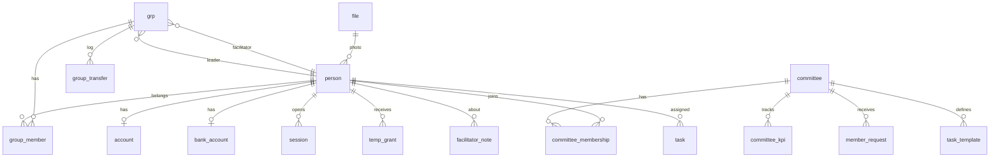
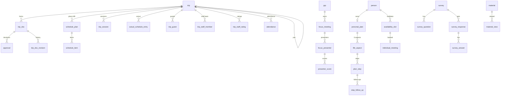
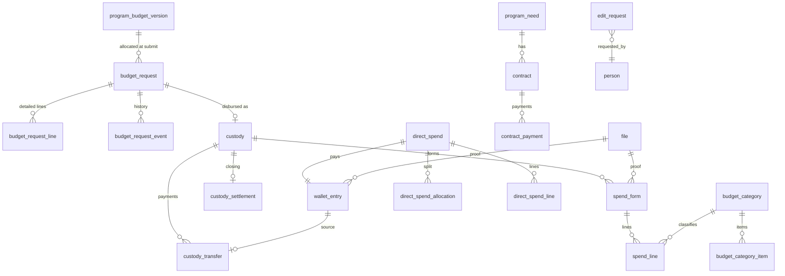

# 4. نموذج البيانات

> الهدف: أن يبني شخص لم يرَ الديمو قاعدة بيانات PostgreSQL كاملة من هذا الملف وحده.
> المصدر: `app/src/domain/types.ts` (واجهة `DB`) مع تصحيحات المنصة الحقيقية (مفاتيح أجنبية، جداول ربط بدل المصفوفات، سجلات غير قابلة للتعديل). ما أُضيف في الحقيقية وليس في الديمو معلَّم بـ **[جديد]**.
> الرموز: `PK` مفتاح أساسي · `FK→t.c` مفتاح أجنبي · `NN` غير فارغ · `UQ` فريد · `CK` قيد تحقق · `idx` فهرس.

## 4.0 اصطلاحات عامة

| البند | القرار |
|---|---|
| المعرّفات | `id uuid PK default gen_random_uuid()` (يُفضّل UUIDv7 من التطبيق لترتيب زمني). معرّفات الديمو النصية (`u1`, `t4`...) لا تُنقل كما هي: تُحوَّل بـ UUIDv5 حتمي (القسم 15). |
| الأسماء | `snake_case` بالإنجليزية، الجدول بالمفرد، وجدول الربط `a_b`. |
| الوقت | اللحظات `timestamptz` (UTC). التواريخ `date`، والساعات `time without time zone`. المنطقة الزمنية للبرنامج `Asia/Riyadh` وتُخزَّن في `program.timezone` وتُستخدم عند العرض والجدولة. (الديمو يستخدم وقت المتصفح المحلي: **غير محدد**، انظر 20 س-09.) |
| المال | `numeric(12,2)` بالريال السعودي، `CHECK (>= 0)` ما لم يُذكر. لا `float` أبداً. (الديمو يقرّب بـ `Math.round(x*100)/100` وهذا غير كافٍ.) |
| الأعمدة الضمنية | كل جدول قابل للتعديل فيه `created_at timestamptz NN default now()` و`updated_at timestamptz NN` (trigger). الجداول التي تعدّلها أطراف متعددة فيها `version int NN default 1` للتزامن المتفائل (`UPDATE ... WHERE version = $n`). |
| الحذف | لا حذف فعلي للكيانات المالية والاعتمادات والتدقيق. الحذف الناعم عبر `hidden`/`disabled`/`revoked_at` حيث ذُكر. |
| الإعدادات | قيم قابلة للتعديل تُخزَّن في الجداول (القسم 4.13) لا في الكود (مبدأ وثيقة القرارات 1). |
| الأنواع المعدودة | `CREATE TYPE ... AS ENUM` (القائمة في 4.1). إضافة قيمة جديدة = migration. |
| اللغة | القيم المخزنة (مفاتيح enum) إنجليزية. النصوص العربية في الواجهة (ملف ترجمة واحد) والرسائل في الخطأ. |

## 4.1 الأنواع المعدودة (ENUM)

| النوع | القيم |
|---|---|
| `person_kind` | `participant`, `staff` |
| `trip_type` | `internal`, `external` |
| `executor_kind` | `group`, `staff` |
| `doc_kind` | `document`, `schedule`, `final_report` |
| `doc_status` | `draft`, `submitted`, `facilitator_approved`, `returned_by_facilitator`, `returned_by_leader`, `approved` |
| `approval_role` / `approval_decision` | `facilitator`,`leader` / `approve`,`reject`,`edit` |
| `schedule_visibility` | `hidden`, `full`, `next24` |
| `focus_status` | `draft`, `published`, `held`, `closed` |
| `choice_mode` | `fixed`, `options`, `free` (للموضوع والتاريخ) |
| `presenter_mode` | `members`, `guest`, `facilitator`, `none` |
| `individual_status` / `individual_origin` | `requested`,`booked`,`done`,`cancelled` / `open_invite`,`personal_invite`,`participant_request` |
| `aspect_key` | `spiritual`,`health`,`family`,`financial`,`social`,`career` |
| `step_status` | `pending`,`started`,`done`,`challenged` |
| `survey_phase` / `survey_ctx` / `question_type` | `pre`,`post` / `trip`,`focus`,`program` / `scale`,`text`,`choice` |
| `material_type` / `material_origin` | `file`,`pdf`,`video`,`link` / `session`,`attached`,`pre_trip`,`individual`,`general`,`focus` |
| `reveal_mode` / `points_status` / `audience_kind` | `auto`,`manual` / `pending`,`approved`,`rejected` / `all`,`group`,`person` |
| `spend_kind` | `internal_trip`,`external_trip`,`focus`,`opening`,`closing`,`meeting`,`program_needs` (7، انظر 20 س-02) |
| `owner_kind` | `trip`,`focus`,`meeting`,`need`,`event` |
| `request_status` | `draft`,`pending_facilitator`,`pending_finance`,`pending_leader`,`needs_detail`,`approved`,`rejected` |
| `request_action` | `submit`,`facilitator_approve`,`facilitator_reject`,`finance_approve`,`finance_reject`,`leader_approve`,`leader_reject`,`leader_request_detail`,`detail_submitted`,`disbursed` |
| `custody_status` | `active`,`closing`,`closed` |
| `line_status` | `pending`,`accepted`,`rejected` |
| `proof_kind` | `invoice`,`transfer_receipt` |
| `wallet_kind` | `deposit`,`surplus_return`,`custody_transfer`,`direct_spend`,`contract_payment`,`deficit_payout` |
| `fee_status` | `paid`,`partial`,`unpaid` |
| `meeting_status` / `meeting_kind` / `recurrence` | `planned`,`held`,`minutes`,`closed` / `periodic`,`urgent` / `none`,`weekly`,`biweekly`,`monthly` |
| `task_status` / `task_scope` / `proof_type` | `new`,`in_progress`,`done` (والمتأخرة **مشتقة** لا حالة) / `general`,`committee`,`trip_team`,`group` / `none`,`link`,`file`,`text` |
| `committee_kind` | `finance`,`media`,`tech`,`general`,`other` |
| `finance_perm` | `view_budget`,`manage_categories`,`approve_within`,`disburse`,`review_invoices`,`close_custody` |
| `temp_perm` | `register_participants`,`edit_site`,`manage_schedule_categories` |
| `attendance_status` / `attendance_kind` | `early`,`on_time`,`late`,`present`,`absent` / `trip`,`focus`,`individual`,`trip_session` |
| `event_kind` | `opening`,`closing` |
| `supporter_kind` / `section_type` / `tcomment_status` | `supporter`,`partner` / `text`,`image`,`people`,`table` / `visible`,`pending`,`hidden` |
| `audit_area` | `finance`,`roles`,`accounts`,`settings` + **[جديد]** `security`,`content` |
| `notification_type` | `focus_created_presenter`,`focus_published`,`groups_published`,`approval_submitted`,`approval_approved`,`approval_rejected`,`deadline_near`,`deadline_passed`,`schedule_started`,`task_assigned`,`custody_issued`,`leader_absent_focus`,`individual_booked`,`plan_step_due`,`committee_member_request`,`trip_published`,`survey_available`,`invoice_rejected`,`budget_request`,`meeting`,`general` |

## 4.2 مخطط العلاقات (ERD)

### (أ) الهوية والمجموعات واللجان



### (ب) الرحلات واللقاءات والخطة الشخصية



### (ج) المالية



## 4.3 الهوية والدخول والصلاحيات

### `person`
| العمود | النوع | قيود | ملاحظات |
|---|---|---|---|
| id | uuid | PK | |
| full_name | text | NN | |
| kind | person_kind | NN | الأساسي: مشارك أو عضو إدارة |
| is_general_leader | boolean | NN default false | `CHECK (NOT is_general_leader OR kind='staff')`؛ **فهرس فريد جزئي**: `UNIQUE (is_general_leader) WHERE is_general_leader` (شخص واحد) |
| email | citext | UQ (يقبل NULL) | الديمو يطلبه ويشتق منه اسم الدخول. الإيميل مؤجّل رسمياً، فنجعله اختيارياً ونضيف `UNIQUE WHERE email IS NOT NULL` |
| phone | text | | يظهر للمشاركين في جهاتهم؟ لا. يظهر فقط لفريق العمل المنشور في رابط الداعم (4.10) |
| university, major | text | | |
| title | text | | منصب فريق العمل المعروض |
| photo_file_id | uuid | FK→file.id | |
| profile_completed_at | timestamptz | | أكمل ملفه (وبه وافق ضمنياً على الشروط) |
| terms_accepted_at | timestamptz | | **[جديد]** إثبات الموافقة الضمنية صراحةً بدل افتراضها من إكمال الملف |
| created_by | uuid | FK→person.id | |
| status | text | CK in ('active','archived') | **[جديد]** أرشفة بعد انتهاء البرنامج |

### `account` (1:1 مع person) — يديره مسؤول اللجنة التقنية وحده
| العمود | النوع | قيود | ملاحظات |
|---|---|---|---|
| person_id | uuid | PK, FK→person.id | |
| username | citext | NN UQ, CK `~ '^[a-z0-9._-]{2,32}$'` | |
| password_hash | text | | **Argon2id** (لا SHA-256). NULL = حساب بلا كلمة مرور بعد |
| must_change_password | boolean | NN default true | تُفرض أول دخول بعد التعيين |
| disabled | boolean | NN default false | |
| failed_attempts | int | NN default 0 | **[جديد]** حد المحاولات الخاطئة |
| locked_until | timestamptz | | **[جديد]** |
| last_login_at | timestamptz | | **[جديد]** |
| password_changed_at | timestamptz | | **[جديد]** |
| updated_by | uuid | FK→person.id | |

### `session` **[جديد]**
`id uuid PK` · `person_id FK` · `token_hash text NN UQ` (SHA-256 للرمز العشوائي في الكوكي) · `created_at` · `expires_at NN` · `last_seen_at` · `ip inet` · `user_agent text` · `revoked_at`. فهرس على `(person_id)`.

### `bank_account` — بيانات حساسة، تُفصل عن `person`
| العمود | النوع | قيود |
|---|---|---|
| person_id | uuid | PK, FK→person.id |
| iban | text | NN, CK `~ '^SA[0-9]{22}$'`، **مشفّر على مستوى التطبيق** (AES-GCM بمفتاح من إدارة الأسرار) |
| bank_name | text | |
| barcode_file_id | uuid | FK→file.id |
القراءة: صاحبها + من يملك `disburse` (وقت التحويل فقط) + مسؤول المالية. سجل قراءة في `audit_log` **[جديد]**.

### `temp_grant`
`id` · `person_id FK NN` · `permission temp_perm NN` · `granted_by FK NN` · `granted_at` · `expires_on date NN` · `revoked_at`. `CK (expires_on >= granted_at::date)`. صلاحية مفعّلة = `revoked_at IS NULL AND expires_on >= today`. فهرس `(person_id, permission)`.

### `capacity_rule` — قواعد تعارض الصفات (بيانات)
`id` · `a text NN` · `b text NN` (قيمة `'any'` = الصفة a حصرية) · `message text NN`. المفاتيح الصالحة: `facilitator, group_leader, tracker, committee_head, committee_member, head:<kind>, member:<kind>, staff_trip_team, trip_substitute, trip_facilitator`. القيم الافتراضية في الملحق ج.
> الصفات نفسها **مشتقة ولا تُخزَّن** (كما في الديمو): ميسّر من `grp.facilitator_id`، قائد مجموعة من `grp.leader_id`، مسؤول لجنة من `committee_membership.role='leader'`، عضو لجنة، متابع دائم من `setting 'tracker_person_id'`، فريق رحلة من `trip_staff_member`، بديل مؤقت من `trip.tracker_substitute_*`. نُنشئ `VIEW v_person_capacity(person_id, capacity_key)` تُستخدم في فحص التعارض وفي كل `can()`.

## 4.4 المجموعات

### `grp`
`id` · `name text NN UQ` · `color text` (hex) · `leader_id FK→person` · `facilitator_id FK→person` · `position int`. `CK`: القائد عضو فعلاً في المجموعة (يُفحص في الخدمة + trigger على `group_member`). الميسّر `kind='staff'`.

### `group_member`
`group_id FK` · `person_id FK` · `joined_at` · **`UNIQUE(person_id)`** (مجموعة واحدة للمشارك). المشارك `kind='participant'`.

### `group_formation` (صف واحد)
`id=1` · `status enum('draft','scheduled','published') NN` · `publish_at timestamptz` · `published_at timestamptz`. المجموعات «منشورة» حين `status='published'` أو `status='scheduled' AND publish_at <= now()` (الدالة `groups_published()`؛ في الحقيقية تُنفَّذ بمهمة مجدولة تقلب الحالة وتُرسل الإشعار، لا بحساب وقت القراءة وحده).

### `group_transfer` (سجل النقل بعد النشر فقط)
`id` · `person_id` · `from_group_id` · `to_group_id` · `by_id` · `at` · `reason`. التعديل قبل النشر لا يكتب هنا.

### `facilitator_note`
`id` · `participant_id FK NN` · `author_id FK NN` · `group_id_at_time FK→grp` · `text NN` · `at`. القراءة: الإدارة فقط (القسم 2). لا يراها المشارك.

### `admin_message` («راسل الإدارة»)
`id` · `from_id FK NN` · `text NN` · `at` · `reply_by FK` · `reply_text` · `reply_at`. مرئي لمرسله وللقائد العام. (س8: تبقى كما هي)

## 4.5 اللجان والمهام والاجتماعات

### `committee`
`id` · `name NN UQ` · `kind committee_kind NN` · `description`. لجنة واحدة على الأكثر من `finance` و`tech` (فهرس فريد جزئي على `kind` لهذين النوعين).
### `committee_kpi`
`id` · `committee_id FK` · `title NN` · `target int NN` · `task_tag text NN`. **القيمة الحية** = `count(task WHERE committee_id AND tag AND status='done')`.
### `committee_membership`
`id` · `committee_id FK NN` · `person_id FK NN` · `role ('leader','member') NN` · `can_see_finance bool` · `finance_perms finance_perm[]` (للجنة المالية فقط) · `UNIQUE(committee_id, person_id)` · فهرس فريد جزئي: مسؤول واحد لكل لجنة `UNIQUE(committee_id) WHERE role='leader'`.
> صاحب `role='leader'` في اللجنة المالية يملك الصلاحيات الست كلها (لا تُخزَّن له). `can_see_finance` مشتق من `view_budget` ويُحدَّث بالخدمة.
### `member_request`
`id` · `committee_id` · `person_id` · `requested_by` · `note` · `status ('pending','approved','rejected')` · `at` · `decided_at` · `decided_by`.

### `task`
| العمود | النوع | ملاحظات |
|---|---|---|
| id | uuid PK | |
| title | text NN | |
| description | text | |
| scope | task_scope NN | |
| committee_id | FK→committee | مطلوب إن `scope='committee'` |
| trip_id | FK→trip | مطلوب إن `scope='trip_team'` |
| focus_meeting_id / meeting_id / group_id | FK | اختيارية حسب الربط |
| assignee_id | FK→person NN | |
| created_by | FK→person NN | |
| due_date | date NN | |
| status | task_status NN default 'new' | |
| proof_type | proof_type NN default 'none' | |
| proof | text | رابط/نص، أو `proof_file_id FK→file` للملف |
| tag | text | يربط المهمة بمؤشر لجنة |
| mandatory | bool | |
| template_id | FK→task_template | أُنشئت تلقائياً |
| done_at | timestamptz | |
`CK (status <> 'done' OR proof_type = 'none' OR proof IS NOT NULL OR proof_file_id IS NOT NULL)` — الإثبات إلزامي للإغلاق. المتأخرة: `status <> 'done' AND due_date < today` (عمود محسوب في view).
### `task_template`
`id` · `committee_id FK` · `title` · `proof_type` · `tag` · `due_offset_days int NN` (نسبة لنهاية الرحلة، السالب قبلها) · `applies_to ('all','internal','external')`.

### `meeting`
`id` · `title NN` · `kind meeting_kind` · `recurrence` · `with_group_leaders bool` · `created_by FK` · `owner_id FK NN` (المسؤول الوحيد، يكتب المحضر) · `date` · `start_time` · `end_time` · `location` · `status meeting_status NN` · `discussion text` · `allocated numeric(12,2)` (مرصود اختياري) · `series_id uuid` (**[جديد]** يربط الاجتماعات الدورية) · `created_at`.
جداول فرعية: `meeting_invitee(meeting_id, person_id)`، `meeting_attendee(meeting_id, person_id)`، `meeting_agenda_item(meeting_id, position, text)`، `meeting_decision(meeting_id, position, text)`، `meeting_output(meeting_id, position, text)`. (الديمو يخزنها مصفوفات نصية.) مهام المحضر تُنشأ في `task` مع `meeting_id`.

### `comment`
`id` · `target_kind ('doc','task','trip')` · `target_id uuid` · `author_id FK` · `text NN` · `kind ('comment','suggestion')` · `at`. (ربط متعدد الأشكال: يُتحقق منه في الخدمة؛ لا FK.) تظهر للميسّر والإدارة منفصلة عن تعديلات الوثيقة.

## 4.6 الرحلات والجدول

### `trip`
| العمود | النوع | قيود/ملاحظات |
|---|---|---|
| id | uuid PK | |
| title | text NN | |
| type | trip_type NN | |
| executor_kind | executor_kind NN | |
| group_id | FK→grp | NN إن `executor_kind='group'` وإلا NULL |
| staff_leader_id | FK→person | NN إن `executor_kind='staff'` |
| start_date, end_date | date NN | `CK end_date >= start_date`؛ `CK type='external' OR end_date = start_date` (الداخلية يوم واحد، بند A21) |
| location, description | text | |
| is_personal_plan_meeting | bool NN default false | **فريد جزئي**: صف واحد فقط `WHERE is_personal_plan_meeting` (الديمو `find()` الأول؛ نجعله قيداً) — انظر 20 س-14 |
| pair_trip_id | FK→trip | الرحلة المزدوجة: كل جزء يشير للآخر؛ `pair_part smallint CK in (1,2)` |
| deadline_document, deadline_schedule, deadline_budget | date NN | نهائية لكل رحلة، افتراضها من الإعدادات |
| published | bool NN default false | + `published_at timestamptz` |
| schedule_visibility | schedule_visibility NN default 'hidden' | |
| schedule_started_notified | bool | تمنع تكرار إشعار «بدأ الجدول» |
| coordination_owner_id | FK→person | مسؤول التنسيقات |
| attendance_taker_id | FK→person | مسؤول التحضير |
| tracker_sub_id | FK→person | المتابع البديل المرشَّح |
| tracker_sub_reason | text | |
| tracker_sub_status | enum('pending','approved','rejected') | |
| plan_unlock_mode | enum('item','time') | لرحلة الخطة الشخصية فقط |
| plan_unlock_item_id | FK→schedule_item | لو mode='item' |
| plan_unlock_at | timestamptz | لو mode='time' |
| team_eval_form, experience_form | text | روابط/أسماء نماذج الإغلاق |
| public_report | text | التقرير العام بعد الاعتماد |
| drive_link | text | يرفعه مسؤول اللجنة الإعلامية |
| closed_at, closed_by | timestamptz, FK | الإغلاق الصريح (زر «أغلق الرحلة») |
| created_by, created_at | | |
> «مرحلة الرحلة» (`document → schedule → budget → trip_data → ready → published → live → closing → closed`) **مشتقة** لا مخزّنة (دالة `trip_stage()` في packages/domain + view `v_trip_stage`). لا نخزّنها كي لا تتعارض مع الحقائق.

### `trip_staff_member` (فريق رحلات فريق العمل)
`trip_id` · `person_id` · `role ('leader','member')` · `UNIQUE(trip_id, person_id)`. يُتحقق عند الإضافة من قواعد التعارض.

### `trip_doc` — ثلاثة نماذج لكل رحلة: `document` و`schedule` و`final_report`
| العمود | النوع | ملاحظات |
|---|---|---|
| id | uuid PK | |
| trip_id | FK NN | |
| kind | doc_kind NN | `UNIQUE(trip_id, kind)` |
| status | doc_status NN default 'draft' | |
| version | int NN default 1 | يزيد عند إعادة الرفع بعد الإرجاع |
| fields | jsonb NN | حقول الوثيقة (`location`, `titles`, `outline`, `summary`, `details`...) — قالب الحقول مخزّن كإعداد **[جديد]** |
| submitted_at, approved_at | timestamptz | |
`final_report` يُنشأ تلقائياً عند اعتماد الجدول (BR-224).
### `trip_doc_revision` **[جديد]** — تاريخ (versioning)
`doc_id` · `version` · `fields jsonb` · `status_at_save` · `saved_by` · `saved_at`. يُكتب snapshot عند كل **رفع** (submit) فيبقى ما رآه الميسّر والقائد العام وقت قراره. (مطلوب لأن الرفض والتعديل يتكرران.)
### `approval`
`id` · `doc_id FK` · `by_id` · `role approval_role` · `decision approval_decision` · `reason text` (إلزامي للرفض: `CK (decision<>'reject' OR reason <> '')`) · `at` · `version int` (نسخة الوثيقة وقتها).

### `schedule_plan`
`id` · `trip_id FK` · `name` (الخطة أ/ب...) · `position int NN` · `UNIQUE(trip_id, position)`. تُنشأ خطتان (أ، ب) مع الرحلة. الخطة الأولى (`position=0`) هي المرجع للجدول الفعلي والحضور.
### `schedule_item`
`id` · `plan_id FK` · `date` · `start_time` · `end_time` (`CK end>start`) · `category_id FK→schedule_category` · `detail text` · `session_id FK→trip_session`.
**قفل البند:** البند الذي بدأ (`date+start_time <= now()` بتوقيت البرنامج) لا يُعدَّل ولا يُحذف، ولا يُضاف بند يبدأ في الماضي → يُفرض في الخدمة **وفي trigger** BEFORE UPDATE/DELETE. (قرار: لا سجل لتعديلات الجدول.)
### `trip_session` (لقاءات داخل الرحلة)
`id` · `trip_id FK` · `title NN` · `presenter text` (نص حر: الضيف قد لا يكون في النظام) · `date`/`start_time`/`end_time` (تُزامَن من بند الجدول المرتبط بالخطة أ).
### `actual_schedule_entry` (ما يثبّته المتابع)
`id` · `trip_id FK` · `ref_item_id FK→schedule_item NN` · `followed enum('A','B','none') NN` · `note` · `actual_start/actual_end time` · `category_id FK` · `by_id FK` · `at` · `UNIQUE(trip_id, ref_item_id)`.
### `trip_guest`
`id` · `trip_id` · `name NN` · `role` · `session_id FK` · `confirmed bool NN default false`.
### `trip_coordination`
`trip_id` · `key enum('housing','transport','food','hosting')` · `status enum('pending','in_progress','done')` · `note` · PK `(trip_id,key)`. الخارجية: 4 مفاتيح، والداخلية 3 (بلا `housing`).
### `trip_staff_rating` — تقييم فريق العمل للرحلة
`trip_id` · `person_id FK (staff)` · `score numeric(4,2) CK 0..10` · `note` · `at` · PK `(trip_id, person_id)` (مرة واحدة).
### `trip_finance_rating`
`trip_id` · `item_key text FK→finance_eval_item.key` · `score int CK 0..5` · `by_id` · PK `(trip_id, item_key)`. يقيّم بها مسؤول المالية وحده.
### `trip_tweet`, `trip_photo` (ملحقات الإغلاق)
`trip_tweet(trip_id, url)`، `trip_photo(trip_id, file_id)`. يرفعها الإعلامية.

### `program_event` (الافتتاحي والختامي)
`id` · `kind event_kind NN` · **`UNIQUE(kind)`** (واحد لكل نوع) · `title` · `date` · `location` · `description` · `status ('planned','done')` · `retroactive bool` (يتخطى التخطيط والتجهيز؛ `CK` التاريخ في الماضي) · `attendees int` · `created_by` · `created_at`.

## 4.7 لقاءات التركيز واللقاءات الفردية والحضور

### `focus_meeting`
| العمود | النوع | ملاحظات |
|---|---|---|
| id | uuid PK | |
| group_id | FK→grp NN | |
| created_by | FK→person NN | الميسّر |
| title | text NN | |
| is_umrah | bool NN default false | لقاء العمرة (علامة + ميزانية مستقلة) |
| topic_mode / date_mode | choice_mode NN | |
| topic | text | إن `fixed` |
| topic_options / date_options | text[] / date[] | إن `options` |
| date, start_time, end_time | date/time | NN عند النشر |
| location | text | |
| presenter_mode | presenter_mode NN | |
| guest_name | text | إن `guest` |
| status | focus_status NN default 'draft' | |
| attendance_taker_id | FK→person | تكليف نائب لهذا اللقاء |
| attendance_confirmed_by | FK→person | |
| seq_in_group | int NN | ترتيب الإنشاء داخل المجموعة؛ يُحسب عند الإدراج في transaction (`max+1`) ويُخزَّن حتى لا يتغير مرصوده لو حُذف لقاء |
`UNIQUE(group_id, seq_in_group)`. عمرة واحدة لكل مجموعة: غير مفروضة في الديمو (المستهدف فقط) فلا قيد.
### `focus_presenter`
`focus_id FK` · `person_id FK` · `axis text` · PK `(focus_id, person_id)`. إلزامي: المقدم عضو في المجموعة.
### `presenter_score` (تقييم الميسّر للمقدّم)
`focus_id` · `person_id` · `criterion_key FK→presentation_criterion.key` · `score smallint CK 1..5` · `by_id` · `at` · PK `(focus_id, person_id, criterion_key)`.

### `availability_slot`
`id` · `facilitator_id FK` · `date` · `start_time` · `end_time` · `invite_kind ('open','person')` · `invited_person_id FK` (إن person) · `booked_by FK→person` · `UNIQUE(id) WHERE booked_by NOT NULL` (الحجز يتم بتحديث شرطي ذرّي `UPDATE ... WHERE booked_by IS NULL`).
### `individual_meeting`
`id` · `facilitator_id` · `participant_id` · `slot_id FK` · `date` · `start_time` · `end_time` · `origin` · `status individual_status` · `request_note` · `notes_on_plan` · `notes_on_meeting` · `attachment_material_id FK→material`.

### `attendance`
| العمود | النوع | ملاحظات |
|---|---|---|
| id | uuid PK | |
| kind | attendance_kind NN | |
| trip_id / focus_meeting_id / individual_meeting_id | FK | **واحد فقط غير فارغ** حسب `kind` (`CK`) — بدل `event_id` متعدد الأشكال في الديمو |
| session_id | FK→trip_session | لـ `trip_session` |
| person_id | FK→person NN | |
| status | attendance_status NN | الرحلة: early/on_time/late/absent؛ غيرها: present/absent |
| present | bool GENERATED (`status <> 'absent'`) | |
| by_id | FK NN | |
| at | timestamptz | |
`UNIQUE(kind, COALESCE(trip_id, focus_meeting_id, individual_meeting_id), COALESCE(session_id, zero-uuid), person_id)`.

## 4.8 الخطة الشخصية والاستبيانات والمكتبة

### `personal_plan`
`participant_id PK FK` · `manually_unlocked bool NN default false` · `updated_at`. تُنشأ عند أول حفظ.
### `life_aspect`
`id` · `plan_id FK` · `key aspect_key NN` · `level smallint NN CK 1..10` · `vision text` · `UNIQUE(plan_id,key)`.
### `life_aspect_level_history` **[جديد، اختياري]**
`aspect_id` · `level` · `at`. لقياس تطور العجلة عبر الوقت (تفعيل «المتابعة الذكية» وتقرير الأثر).
### `plan_step`
`id` · `aspect_id FK` · `title NN` · `start_date NN` · `importance` · `evidence` (أدلة شرعية/علمية) · `how_when` · `status step_status NN default 'pending'` · `position`.
### `step_follow_up`
`id` · `step_id FK` · `at` · `started bool NN` · `progress text` · `challenge text` · `overcome text` · `need_help bool`.
### `final_file`
`participant_id PK FK` · `advice text NN` · `file_id FK→file NN` · `uploaded_by FK (facilitator)` · `at`.

### `survey`
`id` · `title` · `ctx_kind survey_ctx NN` · `trip_id FK` · `focus_meeting_id FK` (حسب ctx؛ `CK` واحد على الأكثر) · `phase survey_phase NN` · `pre_survey_id FK→survey` (للبعدي) · `mandatory bool NN` · `opens_at timestamptz NN` · `created_by FK`.
**قيد:** `UNIQUE(trip_id, phase)` و`UNIQUE(focus_meeting_id, phase)` و`UNIQUE(ctx_kind, phase) WHERE ctx_kind='program'`.
### `survey_question`
`id` · `survey_id FK` · `position` · `text NN` · `type question_type NN` · `options text[]` · `pairs_with_id FK→survey_question` (البعدي ← القبلي) · `is_general bool` (رضا وأثر).
### `survey_response` / `survey_answer`
`survey_response(id, survey_id, person_id, at, UNIQUE(survey_id, person_id))` · `survey_answer(response_id, question_id, value text, PK(response_id,question_id))`.

### `material`
| العمود | النوع | ملاحظات |
|---|---|---|
| id | uuid PK | |
| title | text NN | |
| description | text | |
| type | material_type NN | |
| url | text | رابط خارجي |
| file_id | FK→file | للملفات المرفوعة (إحداهما غير فارغة) |
| uploader_id | FK→person NN | |
| origin | material_origin NN | |
| trip_id / session_id / focus_meeting_id | FK | حسب الأصل |
| reveal_mode | reveal_mode NN | |
| reveal_at | timestamptz | نهاية وقت اللقاء للوضع التلقائي |
| revealed | bool NN | للوضع اليدوي |
| audience_kind | audience_kind NN | |
| audience_group_id / audience_person_id | FK | |
| mandatory | bool | مواد قبلية |
| points_requested | bool | |
| points_status | points_status | يعتمده القائد العام |
| created_at | | |
### `material_view`
`id` · `person_id` · `material_id` · `status ('viewed','skipped')` · `at` · `UNIQUE(person_id, material_id)`.

## 4.9 المالية

### `budget_category` / `budget_category_item`
`budget_category(id, name NN UQ, hidden bool, position)` · `budget_category_item(id, category_id FK, name NN, hidden bool, position)`. **لا حذف** لتصنيف/بند استُخدم (يُخفى). فحص الاستخدام: وجوده في `budget_request_line` أو `spend_line` أو `direct_spend_line`.

### `program_budget_version` — الموازنة العامة مع تاريخ
| العمود | النوع | ملاحظات |
|---|---|---|
| version | int PK | 1 = الأولى (المعالج) |
| setup_at | timestamptz NN | |
| approved_via | FK→edit_request | NULL للنسخة الأولى |
| focus_mode, internal_mode, external_mode | ('per_item','total') | |
| focus_per_item, focus_total, focus_divisor | numeric/int | |
| internal_per_item, internal_total, internal_divisor | numeric/int | |
| external_per_item, external_total, external_divisor | numeric/int | |
| umrah_per_group | numeric(12,2) | |
| opening, closing | numeric(12,2) | |
| meeting_default | numeric(12,2) | |
| program_needs | numeric(12,2) | |
| focus_min, focus_max | int NN default 4, 8 | |
المرصود الجاري = أعلى `version`. **لا تعديل لصف قائم**: التعديل = صف جديد بعد موافقة القائد العام. قبل أول صف: `setupDone=false` (لا تُقبل طلبات).

### `budget_request`
| العمود | النوع | ملاحظات |
|---|---|---|
| id | uuid PK | |
| owner_kind | owner_kind NN | |
| owner_id | uuid NN | يشير إلى trip/focus_meeting/meeting/program_need/program_event حسب النوع (تحقق بالخدمة + trigger) |
| spend_kind | spend_kind NN | |
| requested_by | FK→person NN | |
| amount | numeric(12,2) NN CK >0 | = مجموع الأسطر إن تفصيلية |
| allocated | numeric(12,2) NN | **المرصود وقت التقديم** (لا يتغير بتعديل الموازنة لاحقاً) |
| allocated_version | int FK→program_budget_version | **[جديد]** مرجع النسخة |
| detailed | bool NN | |
| note | text | |
| status | request_status NN default 'draft' | |
| submitted_at | timestamptz | |
| version | int | تزامن |
**قيد:** طلب «قائم» واحد لكل عنصر: `UNIQUE(owner_kind, owner_id) WHERE status NOT IN ('rejected')` تقريباً — الديمو يعيد استخدام الطلب نفسه بعد الرفض (يبقى السجل كاملاً)، لذا: **صف واحد لكل (owner_kind, owner_id)** `UNIQUE(owner_kind, owner_id)`.
### `budget_request_line` (سطر الموازنة التفصيلية)
`id` · `request_id FK` · `category_id FK NN` · `item_id FK` · `description` · `unit text` · `qty numeric(10,2) CK>0` · `price numeric(12,2) CK>=0` · المجموع `qty*price` (عمود محسوب).
### `budget_request_event` (سجل الطلب — لا يُعدَّل)
`id` · `request_id FK` · `at` · `by_id` · `action request_action NN` · `note`.

### `file` — مرفق (القسم 10)
`id` · `storage_key NN UQ` · `original_name` · `mime` · `size_bytes` · **`sha256 char(64) NN`** (يحسبه الخادم) · `purpose text NN` · `uploaded_by FK` · `created_at` · `thumb_key` · `deleted_at`. فهرس على `sha256` (كشف التكرار).

### `wallet_entry` — دفتر محفظة مسؤول المالية (**append-only**)
| العمود | النوع | ملاحظات |
|---|---|---|
| id | uuid PK | |
| kind | wallet_kind NN | |
| amount | numeric(12,2) NN CK >0 | موجب دائماً والاتجاه من النوع |
| at | timestamptz NN | |
| by_id | FK→person NN | |
| attachment_id | FK→file **NN** | لا حركة بلا مرفق |
| source | text | للإيداع: الجهة المحوِّلة |
| note | text | |
| custody_id / direct_spend_id / contract_payment_id | FK | المرجع |
الرصيد = `Σ(deposit, surplus_return) − Σ(custody_transfer, direct_spend, contract_payment, deficit_payout)` (view `v_wallet_balance`). **[جديد]** `REVOKE UPDATE, DELETE` من دور التطبيق؛ التعديل المعتمد عبر دالة `SECURITY DEFINER apply_edit_request()` تكتب `edit_request.applied_diff` (قبل/بعد). وقيد منع الرصيد السالب: trigger `AFTER INSERT` يفشل إن صار الرصيد < 0 (مع قفل صف `wallet_lock` لتفادي سباق الصرف المتزامن).

### `custody` (العهدة)
| العمود | النوع | ملاحظات |
|---|---|---|
| id | uuid PK | |
| request_id | FK→budget_request | NULL للعهد بلا طلب (افتتاحي/ختامي/احتياجات) |
| owner_kind, owner_id | | النشاط |
| spend_kind | spend_kind NN | |
| recipient_id | FK→person NN | المسؤول الكامل |
| approved | numeric(12,2) NN CK>0 | المبلغ المعتمد للعهدة |
| status | custody_status NN default 'active' | |
| close_requested_at | timestamptz | |
| surplus_receipt_id | FK→file | إيصال الفائض يرفعه صاحب العهدة |
| surplus_receipt_at | timestamptz | |
| closed_at, closed_by | | |
| created_by, created_at | | |
### `custody_transfer`
`id` · `custody_id FK` · `amount CK>0` · `at` · `by_id` · `wallet_entry_id FK NN UQ`. مجموع التحويلات ≤ `approved`.
### `custody_settlement`
`custody_id PK FK` · `kind ('surplus','deficit')` · `amount` · `method ('transfer','external')` · `bearer ('finance_officer','holder')` (للخارجية) · `attachment_id FK NN` · `note` · `at` · `by_id` · `wallet_entry_id FK`.

### `spend_form` (نموذج الصرف = فاتورة واحدة أو إيصال تحويل)
`id` · `custody_id FK NN` · `uploaded_by FK NN` · `at` · `vendor text NN` · `serial text` · `invoice_date date NN` · `proof_kind proof_kind NN` · `attachment_id FK→file NN`.
### `spend_line`
| العمود | النوع | ملاحظات |
|---|---|---|
| id | uuid PK | |
| form_id | FK NN | |
| category_id | FK→budget_category | |
| custom_category | text | «غير موجود» باسم مقترح؛ `CK (category_id IS NOT NULL OR custom_category <> '')` |
| item | text NN | شرح حر |
| amount | numeric(12,2) NN CK>0 | |
| status | line_status NN default 'pending' | |
| original_category_id, original_custom_category, original_amount | | تُحفظ عند تعديل المالية |
| review_note | text | إلزامي للرفض |
| reviewed_by, reviewed_at | | |
قيد: لا يُقبل (`accepted`) بند قبل وجود `spend_form.serial` ولا قبل `category_id` غير فارغ. بند `accepted/rejected` لا يتغير (trigger).

### `direct_spend` / `direct_spend_allocation` / `direct_spend_line`
`direct_spend(id, vendor NN, serial, invoice_date, proof_kind, attachment_id NN, total numeric NN, by_id, at, wallet_entry_id FK NN UQ)` · `direct_spend_allocation(direct_spend_id, owner_kind, owner_id, amount CK>0)` · `direct_spend_line(id, direct_spend_id, category_id, custom_category, item, amount)`. **قيد (trigger deferred):** `Σ allocation.amount = Σ line.amount = direct_spend.total` بالضبط.

### `program_need` / `contract` / `contract_payment`
`program_need(id, title NN, description, created_by, at)` · `contract(id, need_id FK NN, vendor NN, title NN, total CK>0, created_by, at)` · `contract_payment(id, contract_id FK, amount CK>0, due_date NN, paid_at, by_id, attachment_id FK, wallet_entry_id FK UQ)`. **قيد deferred:** `Σ payment.amount = contract.total`. الدفعة المدفوعة لا تُعدَّل.

### `edit_request` — تعديل السجلات المعتمدة
`id` · `target_kind enum('spend_line','direct_spend','deposit','program_budget')` · `target_id uuid` (NULL للموازنة) · `patch jsonb NN` · `summary text NN` · `reason text NN` · `requested_by FK` · `at` · `status ('pending','approved','rejected')` · `decided_by` · `decided_at` · `decision_note` · **`applied_diff jsonb`** [جديد] (قبل/بعد). فهرس فريد جزئي: طلب `pending` واحد لكل هدف.

### `fee_record`
`person_id PK FK (participant)` · `amount numeric NN` · `status fee_status NN` · `paid_amount numeric NN` · `exemption text` (سبب نصي ⇒ يُعدّ «مسدد») · `note` · `updated_at`. `CK` الجزئي: `status<>'partial' OR (paid_amount>0 AND paid_amount<amount)`.

### `audit_log` — **append-only** وغير قابل للحذف
`id bigserial PK` · `at timestamptz NN` · `by_id FK` (NULL للنظام) · `area audit_area NN` · `action text NN` · `detail text NN` · `entity_kind text` · `entity_id uuid` · `before jsonb` · `after jsonb` · `ip inet` · `prev_hash`/`hash` **[اختياري]** سلسلة تجزئة تكشف العبث. `REVOKE UPDATE, DELETE`. فهرس `(area, at desc)`.

## 4.10 رابط الداعم والموقع العام

### `supporter_entity`
`id` · `name NN` · `kind supporter_kind NN` · `password_hash text NN` (Argon2id) · `active bool NN` · `logo_file_id FK` · `placement ('above','below')` · `orientation ('horizontal','vertical')` · `is_primary bool` · `position int` · `created_at`. كلمة المرور تحدد الجهة (الديمو): يلزم **تفرّد الكلمات** → نخزّن إلى جانب الهاش `password_lookup` = HMAC-SHA256(سر الخادم, كلمة المرور) بفهرس فريد، ثم نتحقق بـ Argon2id (قرار أمني: انظر 14 و20 س-12).
### `supporter_session` **[جديد]**
`id` · `entity_id FK` · `token_hash UQ` · `expires_at` · `created_at` · `ip`.
### `supporter_login_attempt` **[جديد]**
`id` · `ip_hash text` · `at` · `success bool` · `entity_id`. الحد: 5 خاطئة ⇒ قفل 15 دقيقة (إعداد). (الديمو عدّاد عام واحد لا لكل عنوان.)
### `tracking_comment`
`id` · `entity_id FK` · `name text` · `text NN` · `at` · `status tcomment_status NN` (الافتراضي `pending` إن `setting tracking_comments_need_review`) · `moderated_by FK` · `moderated_at`.

### `site_content` (صف واحد) و `site_section`
`site_content(id=1, hero_title, hero_accent, hero_subtitle, contact_email, program_idea)` · `site_section(id, position int NN, type section_type NN, title NN, hidden bool NN, body text, image_file_id FK, caption text, people_source enum('staff','top5'), table_source enum('manual','participants','groups'), table_columns text[], table_rows jsonb)`. `UNIQUE(position)` deferrable.

## 4.11 الإشعارات والتقييم والنقاط

### `notification`
`id` · `to_id FK NN` · `type notification_type NN` · `title NN` · `body` · `link text` · `created_at` · `read_at timestamptz` · **`dedupe_key text`** [جديد] (`UNIQUE(to_id, dedupe_key)`) لمنع التكرار عند إعادة تشغيل المهام. فهرس `(to_id, read_at, created_at desc)`.
### `job_run` **[جديد]**
`id` · `job text` · `started_at` · `finished_at` · `status` · `detail jsonb` — مراقبة المهام المجدولة (القسم 9.4).

### `notification_policy`
`type notification_type PK` · `email_important bool NN default false` — قائمة «المهم» (بنية جاهزة للإيميل المؤجَّل؛ يملكها مسؤول التقنية).

### جداول إعداد التقييم (مقفلة بعد الحفظ، القسم 8)
| الجدول | الأعمدة |
|---|---|
| `evaluation_item` | `key text PK` · `name` · `scope ('individual','group')` · `weight numeric CK>=0` · `mode ('auto','manual')` · `enabled bool` · `description` · `position` |
| `evaluation_subitem` | `item_key FK` · `key` · `name` · `weight numeric CK>=0` · PK `(item_key,key)` |
| `presentation_criterion` | `key PK` · `name` · `position` |
| `leader_eval_item` | `key PK` · `name` · `max_points numeric CK>0` · `position` (مجموعها 100 افتراضياً) |
| `finance_eval_item` | `key PK` · `name` (يملكه مسؤول المالية، مقياس 0..5) |
| `evaluation_lock` | صف واحد: `locked bool` · `at` · `by_id` |
| `evaluation_config_version` | `version int PK` · `snapshot jsonb NN` (كل قيم التقييم) · `saved_by` · `saved_at` · `reason` — **تاريخ** لكل حفظ؛ يُرجَع إليه لتفسير نقاط قديمة |
القيم المفردة (split، groupTripSplit، deadlineFinalCredit، attendanceWeights، attendanceLateCredit، tripRatingQuorum، presentingExtraBonus، presentingRevealAfterEnd، enrichmentPointsPerMaterial، deadlineDefaults) تُخزَّن في `setting` (4.13) بمفاتيح `eval.*`.

### `leader_evaluation` (تقييم القائد العام الفردي)
`participant_id PK FK (participant)` · `note` · `by_id` · `at` + `leader_evaluation_score(participant_id, item_key FK, score, PK(participant_id,item_key))` مع `CK score<=max`. مرة واحدة لكل مشارك ولا يعدَّل بعد الحفظ.

### `points_run` و`points_entry` — دفتر النقاط **[جديد في هذا الشكل]**
| الجدول | الأعمدة |
|---|---|
| `points_run` | `id` · `started_at` · `finished_at` · `eval_config_version FK` · `reason text` ('event:attendance_saved', 'nightly', 'manual') · `status ('running','ok','failed')` |
| `points_entry` | `id` · `run_id FK NN` · `source_key text NN` · `scope ('individual','group')` · `person_id FK` · `group_id FK` · `trip_id FK` · `item_key FK→evaluation_item` · `sub_key` · `points numeric(8,2) NN CK>=0` · `max_points numeric(8,2)` · `ratio numeric(5,4)` · `detail text` · `auto bool` · `trip_type` · `UNIQUE(run_id, source_key)` |
`CK points >= 0` يضمن «كسب فقط». `v_points_current` = إدخالات آخر `points_run` ناجح. التفاصيل في القسم 8.

## 4.12 الإعدادات

### `setting`
`key text PK` · `value jsonb NN` · `owner ('leader','tech','finance','leader_or_delegate')` · `locked bool NN default false` (للتقييم) · `updated_by FK` · `updated_at` · `version int`. تُعرَّف المفاتيح وقيمها الافتراضية وأصحابها في **الملحق ج**. حفظ مفتاح يتحقق من ملكيته (BR-902).
### `schedule_category`
`id` · `name NN UQ` · `color` · `description` · `requires_prep bool NN` · `hidden bool` · `position`. (يديرها القائد العام أو من فُوّض `manage_schedule_categories`.)
### `ui_config`
صف واحد `value jsonb` يحمل كتالوج القوائم وترتيب كل دور ومحتوى الرئيسية (`navCatalog`, `layouts`, `extras`). الصلاحية نفسها في الكود. يملكه مسؤول التقنية.

## 4.13 ما يتغير مع الوقت ويحتاج تاريخاً (Versioning)

| الكيان | الأسلوب | السبب |
|---|---|---|
| وثائق الرحلة (`trip_doc.fields`) | `trip_doc_revision` عند كل رفع + `approval.version` | الرفض/الإرجاع المتكرر؛ يلزم معرفة ما اعتُمد فعلاً |
| الموازنة العامة | `program_budget_version` (صف جديد لكل اعتماد) | الطلبات تحتفظ بـ`allocated_version`؛ التدقيق |
| إعدادات التقييم | `evaluation_config_version` snapshot + `points_run.eval_config_version` | تفسير نقاط الماضي بعد فتح القفل وتعديله |
| النقاط | `points_run` متتالية append-only | منحنى الترتيب عبر الوقت وتتبع الأخطاء |
| طلب الميزانية | `budget_request_event` (سجل كامل) | قرارات ومبالغ |
| السجلات المالية المعتمدة | `edit_request.applied_diff` + `audit_log.before/after` | «لا تُعدَّل مباشرة» |
| الجدول الزمني | **بلا تاريخ** (قرار وثيقة القرارات) + قفل ما بدأ؛ والفعلي منفصل | قرار صريح |
| النقل بين المجموعات | `group_transfer` | الميسّر الجديد يرى السجل |
| مستوى الجانب في العجلة | `life_aspect_level_history` (اختياري) | قياس الأثر |
| الحسابات وكلمات المرور | `audit_log` (area=accounts) + `account.password_changed_at` | |

## 4.14 أمثلة بيانات (JSON)

> أسماء خيالية فقط. لا تنسخ أسماء الديمو الحقيقية (انظر 15 و19).

**person + account + group**
```json
{
  "person": { "id": "0192e0aa-0001", "full_name": "سالم عبدالله الفهد", "kind": "participant", "university": "جامعة طيبة", "profile_completed_at": "2026-09-02T08:10:00Z" },
  "account": { "person_id": "0192e0aa-0001", "username": "u1", "must_change_password": false, "disabled": false },
  "group_member": { "group_id": "0192e0bb-0001", "person_id": "0192e0aa-0001" },
  "grp": { "id": "0192e0bb-0001", "name": "مجموعة أُحُد", "color": "#00708c", "leader_id": "0192e0aa-0001", "facilitator_id": "0192e0aa-0100" }
}
```

**trip + docs + approval**
```json
{
  "trip": { "id": "t-uhud-int", "title": "رحلة أُحُد الداخلية", "type": "internal", "executor_kind": "group", "group_id": "0192e0bb-0001",
            "start_date": "2026-11-12", "end_date": "2026-11-12",
            "deadline_document": "2026-10-22", "deadline_schedule": "2026-11-02", "deadline_budget": "2026-11-02",
            "published": false, "schedule_visibility": "hidden", "is_personal_plan_meeting": false },
  "trip_doc": { "kind": "document", "status": "facilitator_approved", "version": 2,
                "fields": { "location": "جبل أُحُد", "titles": "القيادة بالقدوة", "outline": "جولة ثم محاضرة ثم ورشة" } },
  "approval": [ { "role": "facilitator", "decision": "reject", "reason": "العناوين عامة", "version": 1 },
                { "role": "facilitator", "decision": "approve", "version": 2 } ]
}
```

**budget_request + custody + spend_line**
```json
{
  "budget_request": { "owner_kind": "trip", "spend_kind": "internal_trip", "amount": 3240.00, "allocated": 3500.00, "allocated_version": 1,
                      "detailed": true, "status": "approved",
                      "lines": [ { "category": "المواصلات", "description": "باص كوستر", "unit": "يوم", "qty": 1, "price": 1000.00 } ] },
  "custody": { "approved": 3240.00, "status": "active", "recipient_id": "0192e0aa-0001",
               "transfers": [ { "amount": 2000.00, "wallet_entry": "we-1" } ] },
  "spend_form": { "vendor": "مؤسسة النقل", "serial": "A-7731", "invoice_date": "2026-11-10", "proof_kind": "invoice",
                  "lines": [ { "category": "المواصلات", "item": "عربون الباص", "amount": 500.00, "status": "accepted" } ] }
}
```

**wallet_entry**
```json
{ "kind": "deposit", "amount": 30000.00, "source": "الجمعية (الدفعة الأولى)", "attachment_id": "file-9", "by_id": "fin-head" }
```

**points_entry**
```json
{ "run_id": "run-77", "source_key": "ind:0192e0aa-0001:attendance", "scope": "individual", "person_id": "0192e0aa-0001",
  "item_key": "attendance", "points": 18.40, "max_points": 22.50, "ratio": 0.8178, "auto": true,
  "detail": "التركيز 3/4 · الرحلات 2.5/3 · لقاءات الرحلة 5/6" }
```

**focus_meeting**
```json
{ "group_id": "0192e0bb-0001", "seq_in_group": 5, "title": "لقاء العمرة", "is_umrah": true, "topic_mode": "fixed", "topic": "العمرة: معانٍ ودروس",
  "date": "2026-12-18", "start_time": "04:00", "end_time": "12:00", "presenter_mode": "facilitator", "status": "draft" }
```

## 4.15 فهارس وقيود إضافية ملخّصة

- فهارس FK كلها، و`(trip_id, kind)` على `trip_doc`، و`(to_id, read_at)` على `notification`، و`(status)` على `budget_request` و`custody`، و`(sha256)` على `file`.
- Triggers: قفل بنود الجدول المبدوءة · منع تعديل `wallet_entry`/`audit_log` · منع تغيير `spend_line` بعد المراجعة · التحقق المؤجل لمجاميع التوزيع والعقد · منع الرصيد السالب · `updated_at`.
- Row Level Security على: `facilitator_note`, `personal_plan` وفروعه, `bank_account`, كل جداول المالية, `audit_log`, `account` (القسم 14).
