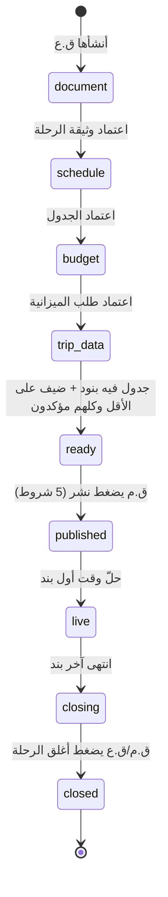
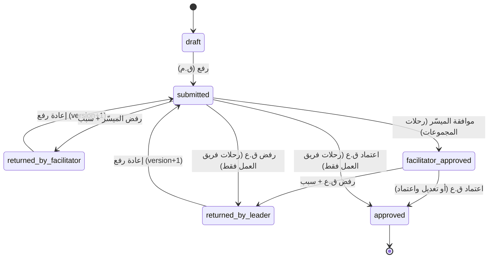
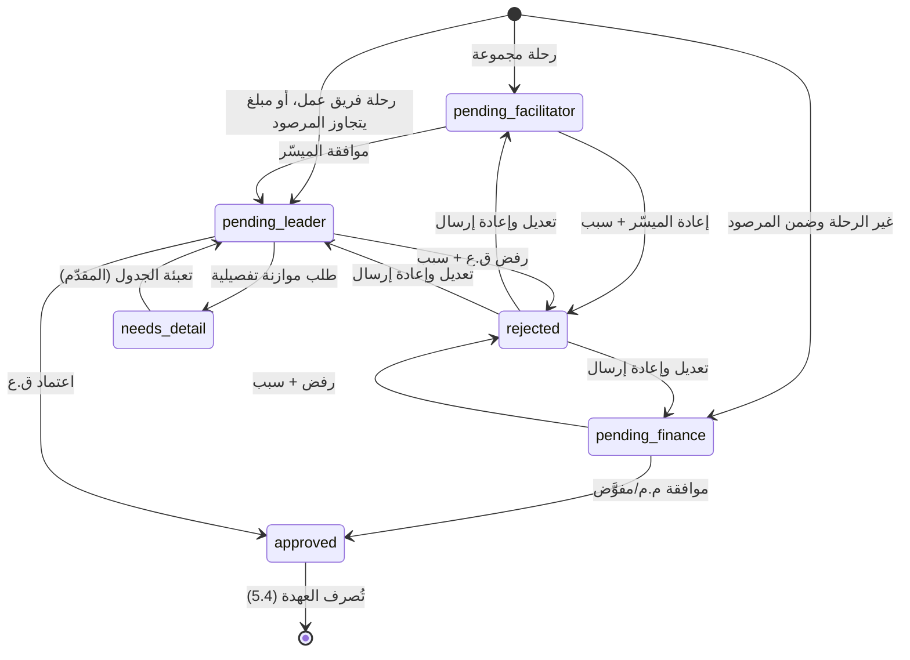
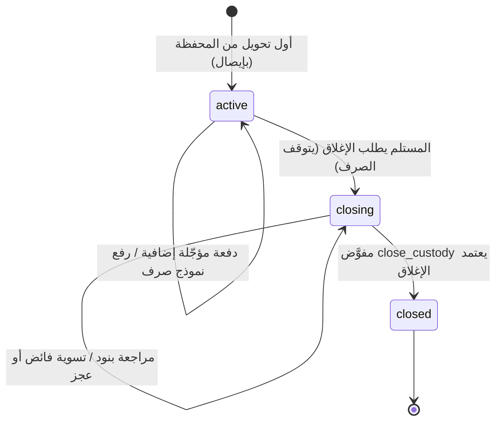
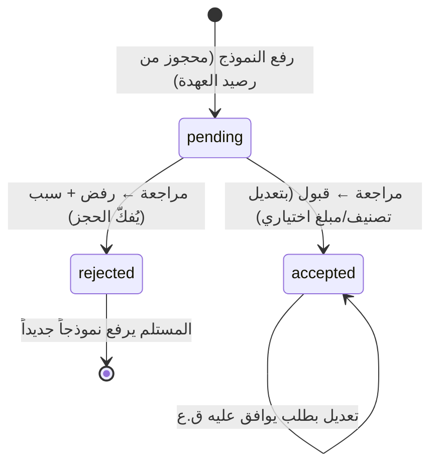
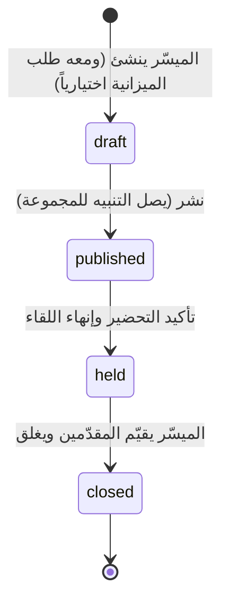
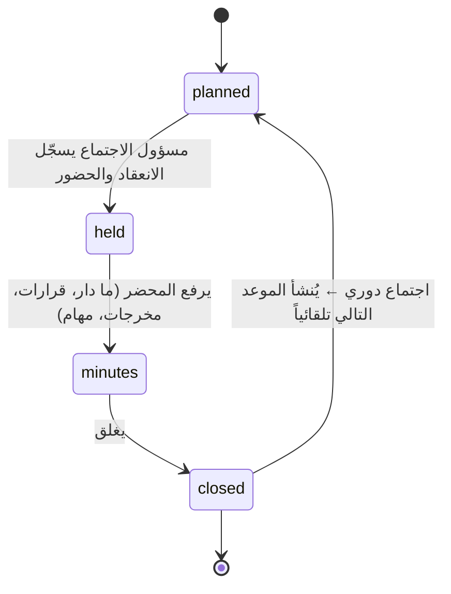
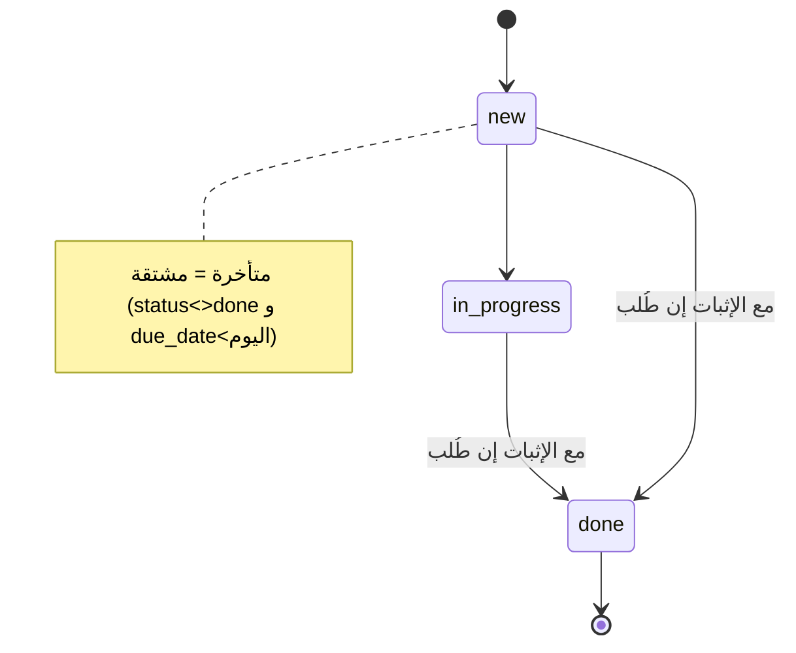
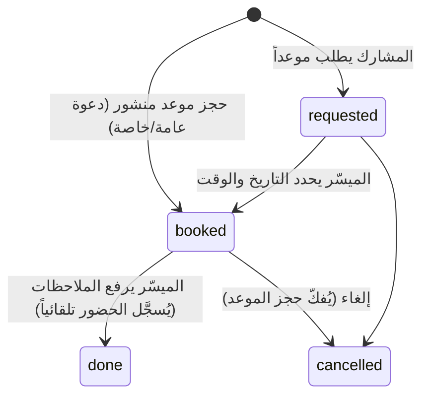

# 5. آلات الحالة (State Machines)

> المصدر: `app/src/domain/workflow.ts`، `finance.ts`، `ledger.ts`، `data/repositories.ts`، ووثيقة القرارات. رموز الأدوار: **ق.ع** القائد العام · **ميسّر** · **ق.م** قائد المجموعة (قائد فريق الرحلة) · **م.م** مسؤول المالية · **مفوَّض:perm** عضو مالي بصلاحية · **مالك** صاحب الطلب/العهدة.
> «يُشغَّل» = ما يحدث مع الانتقال: **[إشعار]** داخل المنصة، **[تدقيق]** سطر في `audit_log`، **[حساب]** إعادة حساب النقاط (القسم 8) أو أرقام مشتقة.
> ملاحظة عامة: كل انتقال يتم **داخل transaction واحدة** في الخادم مع `SELECT ... FOR UPDATE` على الصف ومقارنة `version`، فينجح انتقال واحد فقط عند التزامن. الديمو لا يفحص الحالة السابقة في بعض الإجراءات (مذكورة بـ ⚠️) ويعتمد على الواجهة، والحقيقية **يجب** أن تفرضها.

---

## 5.1 الرحلة (Trip)

«المرحلة» مشتقة من الحقائق (لا عمود حالة). الانتقالات تحدث بتغيّر الحقائق، وبالزمن.

| من → إلى | الحدث | من | الشرط | يُشغَّل |
|---|---|---|---|---|
| ∅ → document | إنشاء الرحلة | ق.ع | عنوان؛ نوع؛ منفّذ؛ تاريخ؛ الداخلية يوم واحد؛ في رحلات المجموعات المجموعة موجودة؛ الفريق بلا تعارض صفات | يُنشأ `trip_doc` (document وschedule) · تُنشأ المهام التلقائية من القالب · [إشعار] للفريق «أُسندت إليكم رحلة»، وللجميع «أُدرجت في التقويم» · [تدقيق] إسناد صفات (فريق العمل) |
| document → schedule | اعتماد الوثيقة (5.2) | ق.ع | — | |
| schedule → budget | اعتماد الجدول | ق.ع | — | يُنشأ `final_report` (مسودة) |
| budget → trip_data | اعتماد طلب الميزانية (5.3) | ق.ع (رحلات المجموعات بعد الميسّر) | — | [حساب] |
| trip_data → ready | تحقق تلقائي | — | `hasSchedule` (خطة أ فيها بند) ∧ ضيف ≥1 ∧ كل الضيوف `confirmed` | |
| ready → published | **نشر** | ق.م (قائد فريق الرحلة) | `publishChecks` الخمسة (BR-210) | `published_at` · [إشعار] `trip_published` للجميع · يُنشأ الاستبيان القبلي الإلزامي إن لم يوجد · [حساب] |
| published → live | الزمن | النظام | `now ≥ أول بند في الخطة أ` (أو 08:00 من تاريخ البدء بلا بنود) | **مهمة مجدولة**: [إشعار] `schedule_started` للمشاركين والفريق مرة واحدة (`schedule_started_notified`) — في الديمو يُرسل عند أول فتح للصفحة |
| live → closing | الزمن | النظام | `now > آخر بند` (أو 23:00 من تاريخ النهاية) | مهمة مجدولة: يُنشأ الاستبيان البعدي (إلزامي) من القبلي + أسئلة الرضا ويُرسل `survey_available` |
| closing → closed | **إغلاق** | ق.م أو ق.ع | الرحلة انتهت ∧ تقييمات فريق العمل ≥ النصاب ∧ متطلبات الإغلاق الستة (BR-241) | `closed_at/closed_by` · [إشعار] للفريق · [حساب] (بنود الإغلاق في الموعد) |
> ⚠️ لا رجوع من `published` إلى `ready` (لا إلغاء نشر في الديمو). إلغاء النشر = **قرار مفتوح** (20 س-15 فرعي).
> الرحلة المزدوجة: تغيير `end_date` للجزء 1 يحدّث `start_date` للجزء 2 تلقائياً وبالعكس، ويُرفض إن صار الجزء الآخر بلا مدة.

---

## 5.2 وثيقة الرحلة والجدول والتقرير الختامي — دورة الاعتماد (`trip_doc`)

لكل من `document` و`schedule` و`final_report`. رحلات **المجموعات**: ق.م ← ميسّر ← ق.ع. رحلات **فريق العمل**: الفريق ← ق.ع مباشرة (ق.ع هو الميسّر).

| من → إلى | الحدث | من | الشرط | يُشغَّل |
|---|---|---|---|---|
| draft/returned_* → submitted | `submit` | ق.م (هو وحده يعدّل) | حالة قابلة للتعديل ∧ `tripFormBlock`: رحلات المجموعات بعد **نشر التشكيل**؛ غير الوثيقة بعد **رفع الوثيقة** أولاً؛ `final_report` بعد انتهاء الرحلة (BR-226، ⚠️ في الواجهة فقط بالديمو) | `submitted_at` أول مرة · `version+1` عند إعادة الرفع · snapshot في `trip_doc_revision` · [إشعار] `approval_submitted` للميسّر (وللقائد العام في رحلات الفريق) |
| submitted → facilitator_approved | `facilitator_approve` | ميسّر المجموعة المنفِّذة | رحلة مجموعة ∧ الحالة `submitted` | `approval` · [إشعار] للقائد العام «بانتظار قرارك»، ولكل فريق العمل «معروضة للنقاش»، وللفريق «وافق الميسّر» |
| submitted → returned_by_facilitator | `facilitator_reject` | الميسّر | سبب غير فارغ | `approval(reject, reason)` · [إشعار] `approval_rejected` للفريق · تعود نموذجاً قابلاً للتعديل |
| facilitator_approved → approved | `leader_approve` / `leader_edit_approve(reason)` | ق.ع | الحالة `facilitator_approved` (أو `submitted` لرحلات الفريق) | `approved_at` · `approval(approve|edit)` · [إشعار] `approval_approved` للفريق والميسّر · إن `schedule`: يُنشأ `final_report` · [حساب] |
| facilitator_approved/submitted → returned_by_leader | `leader_reject` | ق.ع | سبب ⚠️ (الديمو لا يتحقق من الحالة السابقة هنا؛ الحقيقية: من `facilitator_approved` أو `submitted`-فريق فقط) | [إشعار] لقائد المجموعة **وللميسّر**؛ **تعود لقائد المجموعة لا للميسّر** |
> بعد `approved`: لا تعديل على حقول الوثيقة. **استثناء مقصود:** بنود الجدول تبقى قابلة للتعديل قبل بدايتها بلا إعادة اعتماد (قرار وثيقة القرارات)، لأن محرر الجدول مستقل عن حالة الاعتماد (BR-222).
> التعليقات والاقتراحات (`comment`) لا تغيّر الحالة.

---

## 5.3 طلب الميزانية (`budget_request`)

| من → إلى | الحدث | من | الشرط | يُشغَّل |
|---|---|---|---|---|
| ∅/rejected → pending_* | `submit` | مقدّم الطلب: الميسّر للقاء التركيز · ق.م للرحلة (قائد فريق الرحلة) · مسؤول الاجتماع للاجتماع | الموازنة العامة محفوظة (`setupDone`) · النوع ليس `need` · الرحلة: **أسطر تفصيلية** ≥1 ∧ `tripFormBlock('budget')` · لقاء التركيز: ترتيبه ≤ الحد الأعلى (8) وإلا المرصود 0 ولا يُطلب · لا طلب قائم بحالة غير (draft/rejected/needs_detail) · المبلغ >0 | `allocated` = المرصود وقت التقديم (+`allocated_version`) · يُحدَّد المسار (`firstStatusFor`) ثم [إشعار] للمعتمد المناسب · `budget_request_event(submit)` · `submitted_at` أول مرة |
| pending_facilitator → pending_leader | `facilitator_approve` | الميسّر المنفِّذ | الحالة | [إشعار] للقائد العام (مع تنبيه التجاوز إن `amount>allocated`) |
| pending_facilitator → rejected | `facilitator_reject` | الميسّر | سبب | [إشعار] لمقدّم الطلب |
| pending_finance → approved | `finance_approve` | عضو مالي بـ`approve_within` | `requested_by ≠ actor` | [تدقيق] · [إشعار] للمقدّم |
| pending_finance → rejected | `finance_reject` | نفسه | سبب + `requested_by ≠ actor` | [تدقيق] · [إشعار] للمقدّم |
| pending_leader → approved | `leader_approve` | ق.ع | — | [تدقيق] («اعتماد ميزانية تتجاوز المرصود» إن تجاوز) · [إشعار] للمقدّم، ولكل من يملك `disburse` «حوّل العهدة» · [حساب] لرحلة |
| pending_leader → rejected | `leader_reject` | ق.ع | سبب | [تدقيق] · [إشعار] |
| pending_leader → needs_detail | `leader_request_detail` | ق.ع | سبب/مطلوب | [تدقيق] · [إشعار] للمقدّم «عبّئ الموازنة التفصيلية» |
| needs_detail → pending_leader | `detail_submitted` | المقدّم | أسطر تفصيلية | يعود للقائد العام مباشرة (لا يمر بمسار المرصود) |
> قاعدة المسار: `firstStatusFor` — رحلة مجموعة ⇒ الميسّر؛ رحلة فريق ⇒ ق.ع؛ غيرها: `amount ≤ allocated` ⇒ المالية، وإلا ⇒ ق.ع.
> **بعد الاعتماد** تمتد «الحالة والخطوة التالية» لمراحل العهدة (`requestStage`): بانتظار الصرف ← عهدة مفعّلة ← بنود بانتظار المراجعة ← قيد الإغلاق ← مغلق.
> لا حالة `draft` فعلية في الديمو (الطلب يُنشأ عند الإرسال)؛ نبقيها للمسودات المحفوظة قبل الإرسال (اختياري).

---

## 5.4 العهدة (`custody`)

| من → إلى | الحدث | من | الشرط | يُشغَّل |
|---|---|---|---|---|
| ∅ → active | `disburse` (من طلب معتمد) أو `issueCustody` (بلا طلب: افتتاحي/ختامي/احتياجات) | مفوَّض:disburse | الطلب `approved` ولا عهدة له · قاعدة العهد المتزامنة (BR-517) · مبلغ التحويل ∈ (0، المعتمد] · إيصال إلزامي · الرصيد الفعلي يكفي (وإلا يُحوَّل جزء ويبقى الباقي دفعة ثانية) | `wallet_entry(custody_transfer)` + `custody_transfer` · `budget_request_event(disbursed)` · [تدقيق] · [إشعار] `custody_issued` للمستلم · تُكمَل مهمة «صرف العهدة» التلقائية |
| active → active | `transferMore` | مفوَّض:disburse | الحالة active ∧ المبلغ ≤ المتبقي من المعتمد ∧ رصيد كافٍ ∧ إيصال | [تدقيق] · [إشعار] للمستلم |
| active (نماذج) | `submitSpendForm` | المستلم وحده | الحالة active ∧ إثبات (صورة) ∧ مورد وتاريخ ∧ سطر ≥1 صالح | يُقبل **ولو تجاوز رصيد العهدة** (يُسجَّل عجزاً) · [إشعار] لمراجعي الفواتير مع تنبيه التكرار/التجزئة |
| active → closing | `requestClose` | المستلم | الحالة active | `close_requested_at` · [إشعار] لمفوّضي الإغلاق |
| closing (فائض) | `submitSurplusReturn` | المستلم | إيصال تحويل الفائض | [إشعار] لمفوّضي الإغلاق |
| closing (تسوية) | `settle` | مفوَّض:close_custody | الحالة closing ∧ كل البنود رُوجعت ∧ إن فائض: وصل إيصال المستلم ∧ إن عجز: إيصال تحويل (ورصيد كافٍ) أو تسوية خارجية بحامل محدد ومستند | فائض: `wallet_entry(surplus_return)` · عجز-تحويل: `wallet_entry(deficit_payout)` · [تدقيق] |
| closing → closed | `closeCustody` | مفوَّض:close_custody | `custodyCloseChecks` (طلب إغلاق ∧ نموذج ≥1 ∧ لا بنود معلّقة ∧ تسوية الفائض/العجز) | `closed_at/by` · [تدقيق] · تُكمَل مهمة «الإغلاق المالي» · [إشعار] للمستلم · [حساب] (الإغلاق المالي في الموعد) |
> الأرقام: `transferred = Σ transfers`، `accepted = Σ سطور مقبولة`، `held = Σ سطور معلّقة`، `balance = transferred − accepted`، `available = balance − held`، `surplus = max(0,balance)`، `deficit = max(0,−balance)`، `toTransfer = max(0, approved − transferred)`.
> ⚠️ الديمو يسمح بمراجعة البنود في أي حالة للعهدة؛ الحقيقية تسمح بها في `active` و`closing` فقط.

---

## 5.5 نموذج الصرف وسطر الفاتورة (`spend_form` / `spend_line`)

المراجعة **لكل سطر على حدة**. النموذج لا حالة له بل حالته مشتقة (له أسطر معلّقة؟).

| من → إلى | الحدث | من | الشرط | يُشغَّل |
|---|---|---|---|---|
| ∅ → pending | رفع النموذج | مالك العهدة | (5.4) | تحذيرات: تكرار (صورة/رقم+مورد/مورد+مبلغ+تاريخ) وتجزئة |
| pending → accepted | `reviewLine(accept)` | مفوَّض:review_invoices | **ليس مالك العهدة** · الرقم التسلسلي للنموذج موجود (يُدخله المراجع إن غاب) · تصنيف من القائمة محدد (لبند «غير موجود» يُربط أولاً) · المبلغ >0 · يُحفظ الأصل في `original_*` إن عُدّل | [تدقيق] · يُقفل السطر |
| pending → rejected | `reviewLine(reject)` | نفسه | سبب إلزامي | [إشعار] `invoice_rejected` للمستلم · [تدقيق] · يُفكّ الحجز |
| accepted → accepted | `requestEdit(spend_line)` ثم `decideEdit` | م.م/مفوَّض ثم ق.ع | البند مقبول ∧ لا طلب قائم لنفس الهدف | `apply_edit_request` · [تدقيق] |

---

## 5.6 لقاء التركيز (`focus_meeting`)

| من → إلى | الحدث | من | الشرط | يُشغَّل |
|---|---|---|---|---|
| ∅ → draft | `create` | الميسّر (لمجموعته) | عنوان؛ مقدّم صالح (أعضاء من المجموعة، أو ضيف باسم، أو الميسّر/لا أحد)؛ موضوع/تاريخ حسب الوضع؛ نهاية>بداية | `seq_in_group` · [إشعار] `focus_created_presenter` للمقدّمين · إن طلب ميزانية وكان ترتيبه ≤8 والموازنة محفوظة ⇒ طلب ميزانية (5.3) |
| draft → published | `publish` ⚠️ (لا فحص دور بالديمو) | الميسّر | التاريخ محدد | [إشعار] `focus_published` لأعضاء المجموعة · يظهر في تقويمها |
| (قبل الموعد) | `setPresenter` | الميسّر | قبل موعد اللقاء ولم ينعقد | [إشعار] للمقدّم الجديد |
| published → held | `markHeld` | مسجّل الحضور: ق.م أو من كُلّف لهذا اللقاء، أو الميسّر | يوم اللقاء أو بعده | `attendance_confirmed_by` · يُنشأ استبيان اختياري ويُرسل · إن لم يحضر ق.م ولم يُكلَّف نائباً ⇒ [إشعار] `leader_absent_focus` للميسّر · [حساب] |
| held → closed | `close` | الميسّر | **مقترح** (غير محدد بالديمو): تقييم كل مقدّم عضو بكل المعايير | [حساب] (نقاط التقديم) |
> المشاركون لا يقيّمون اللقاء، الميسّر يقيّم المقدّم فقط (1–5 لكل معيار).

---

## 5.7 الاجتماع (`meeting`)

| من → إلى | الحدث | من | الشرط | يُشغَّل |
|---|---|---|---|---|
| ∅ → planned | `create` | أي عضو فريق عمل (المشارك وق.م لا ينشئان؛ ق.م «يطلب» بنموذج الطلب ويُدعى له ق.ع افتراضياً) | عنوان، مسؤول، موعد | [إشعار] `meeting` للمدعوين · مع طلب ميزانية إن كانت ميزانية الاجتماعات معتمدة وكان المنشئ هو المسؤول |
| planned → held | `markHeld` ⚠️ | المسؤول | تاريخ الاجتماع بلغ أو مضى | يُسجَّل الحضور |
| held → minutes | `saveMinutes` | المسؤول فقط | ما دار؛ قرارات؛ مخرجات؛ مهام (عنوان، مسؤول، موعد) | تُنشأ مهام `scope=general` مربوطة بالاجتماع بلا إثبات · [إشعار] `task_assigned` · [إشعار] `meeting` للمدعوين |
| minutes → closed | `close` | المسؤول | — | الدوري: يُنشأ اجتماع جديد `planned` بعد (7/14/30 يوماً) |
> يراه: المدعوون، المسؤول، المنشئ، ق.ع، ومسؤول المالية (ليضع المرصود).

---

## 5.8 المهمة (`task`)

| الانتقال | من | الشرط | يُشغَّل |
|---|---|---|---|
| إنشاء | ق.ع · قائد اللجنة (لعضو لجنة) · أي عضو إدارة (لوحة المهام العامة) · مشارك لمشارك في مجموعته · التلقائية من القالب عند إنشاء رحلة | مهمة لجنة: المنشئ يرى اللجنة | [إشعار] `task_assigned` للمسند إليه |
| new/in_progress → done | المسند إليه (أو منشئ المهمة) | `proof_type<>none` ⇒ إثبات (رابط/نص/ملف) غير فارغ | `done_at` · يُحدّث مؤشر اللجنة الحي بالوسم · [حساب] لمهام الرحلة (إن اعتُمدت بنداً) |
| done → غير done | **غير مسموح** (مقترح؛ الديمو يسمح بأي patch) | | |
| تغيير المسند | المنشئ | | [إشعار] |

---

## 5.9 اللقاء الفردي والموعد المتاح

| الانتقال | من | الشرط | يُشغَّل |
|---|---|---|---|
| نشر موعد (`availability_slot`) | الميسّر | تاريخ/ساعتان | [إشعار] لأعضاء المجموعة (عامة) أو للشخص المحدد |
| حجز موعد → booked | المشارك (المدعو أو أي عضو عند الدعوة العامة) | الموعد غير محجوز: `UPDATE ... WHERE booked_by IS NULL` (ذرّي) | [إشعار] `individual_booked` للميسّر والمشارك |
| طلب موعد → requested | المشارك | عضو في مجموعة | [إشعار] للميسّر |
| requested → booked | الميسّر | | [إشعار] للمشارك |
| booked → done | الميسّر | ملاحظات على الخطة وعلى اللقاء؛ مرفق اختياري يظهر في مكتبة المشارك | `attendance(individual, present)` · [إشعار] للمشارك · [حساب] (بند الخطة الشخصية) |

---

## 5.10 دورات صغيرة

| الكيان | الحالات والانتقالات | من يملكها | شروط/آثار |
|---|---|---|---|
| **طلب عضوية لجنة** `member_request` | pending → approved/rejected | ق.ع | قائد اللجنة يطلب؛ القبول يُنشئ `committee_membership` بدور وصلاحيات يحددها ق.ع بعد فحص التعارض؛ [تدقيق] roles؛ [إشعار] للطالب وللشخص |
| **المتابع البديل** `trip.tracker_sub_*` | (لا شيء) → pending → approved/rejected | يرشّحه المتابع الدائم، ويعتمده ق.ع | المرشَّح ليس ميسّر الرحلة، ولا تعارض صفات (`substituteConflict`)؛ المالية والإدارة العامة مستثناة؛ عند الاعتماد: [إشعار] للبديل ويصبح `effectiveTrackerId` |
| **طلب تعديل سجل معتمد** `edit_request` | pending → approved/rejected | يطلب م.م/مفوَّض صلاحية تنفيذية، ويقرر ق.ع | طلب `pending` واحد لكل هدف؛ الموافقة تُطبّق `patch` وتحفظ `applied_diff`؛ الرفض بسبب؛ [تدقيق] [إشعار] |
| **نقاط مادة إثرائية** `material.points_status` | (لا طلب) → pending → approved/rejected | ق.ع | عامة (`audience=all`) فقط؛ [إشعار] للرافع |
| **تشكيل المجموعات** `group_formation` | draft → scheduled → published | ق.ع | draft: تعديل حر بلا سجل نقل؛ published: النقل يُسجَّل ويُنبَّه الأطراف؛ **لا رجوع من published** (الديمو يملك `unpublish` للاختبار فقط ولا واجهة له) |
| **قفل التقييم** `evaluation_lock` | unlocked → locked (عند أي حفظ) → unlocked | يحفظ ق.ع (أو م.ت)؛ يفتح م.ت وحده بسبب | الفتح: [تدقيق] settings + [إشعار] للقائد العام؛ الحفظ يلتقط `evaluation_config_version` ويُطلق إعادة حساب النقاط كاملة |
| **دفعة عقد** `contract_payment` | unpaid → paid | مفوَّض:disburse | فاتورة/إيصال ورصيد كافٍ؛ لا تعديل بعد الدفع |
| **تعليق الداعم** `tracking_comment` | pending → visible/hidden | فريق العمل (قسم رابط الداعم) | الافتراضي pending (إعداد)؛ [إشعار] للإعلامية عند الورود |
| **الحساب** `account` | بلا كلمة → فعّال(مؤقتة) → فعّال ↔ معطّل | م.ت وحده (تعطيل/إعادة تعيين/اسم الدخول) | إعادة التعيين تولّد مؤقتة تظهر مرة واحدة وتُغيَّر إلزامياً؛ لا يعطّل حسابه بنفسه؛ [تدقيق] accounts |
| **الصلاحية المؤقتة** `temp_grant` | نشطة ← منتهية (التاريخ) / مسحوبة | ق.ع | نشطة ⇔ لم تُسحب ∧ اليوم ≤ `expires_on` |
| **جلسة الداعم/القفل** | منفتحة → مقفلة 15 دقيقة بعد 5 خاطئة | النظام | العدّاد لكل عنوان IP (+ عام) في الحقيقية |
| **الخطوة في الخطة** `plan_step` | pending → started/done/challenged (بأي ترتيب عبر المتابعة) | صاحب الخطة | `need_help` ⇒ [إشعار] `plan_step_due` للميسّر؛ تاريخ البدء بلغ و`pending` ⇒ مطلوب «وش صار؟» |
| **الخطة الشخصية (القفل)** | مقفلة → مفتوحة | تلقائي عند بند/توقيت الفتح في رحلة الخطة (إن نُشرت)، أو يدوي من ق.ع (`manually_unlocked`) | مشتقة؛ تُحسب في الخدمة |
| **الاستبيان** | غير مفتوح (`opens_at` مستقبلاً) → مفتوح | تلقائي بالزمن | العام البعدي لا يُنشأ قبل وجود استبيان لآخر رحلة خارجية (BR-407) |
| **المواد** | مخفية → مكشوفة | تلقائي عند `reveal_at` (نهاية وقت اللقاء) أو يدوي `revealed=true` من الرافع | |

---

## 5.11 جدول زمني للأحداث الزمنية (تحتاج مجدول)

الديمو لا يملك مجدولاً، فيكتفي بالتوليد عند فتح الصفحة. المنصة الحقيقية تحتاج مهام مجدولة (القسم 9.4):

| الحدث الزمني | يشغّل |
|---|---|
| حلول `publish_at` للتشكيل | `published` + إشعار `groups_published` |
| اقتراب الموعد النهائي (`reminderDaysBefore`=3) وفواته | `deadline_near` / `deadline_passed` (النوعان معرّفان بالديمو ولا يُولَّدان) |
| بدء أول بند في رحلة منشورة | `schedule_started` |
| انتهاء الرحلة | استبيان بعدي · تذكير بتقييم الفريق (`staff_rating`) |
| حلول تاريخ خطوة في الخطة الشخصية | `plan_step_due` |
| فتح الخطة الشخصية (بند/توقيت) | إشعار للمشاركين |
| انتهاء الصلاحية المؤقتة | تنظيف + إشعار اختياري |
| `opens_at` للاستبيان | `survey_available` |
| إعادة حساب النقاط الليلية | `points_run` |
| فوات مهلة الإغلاق (14 يوماً) | تُحسب في النقاط (صفر) + `deadline_passed` |
